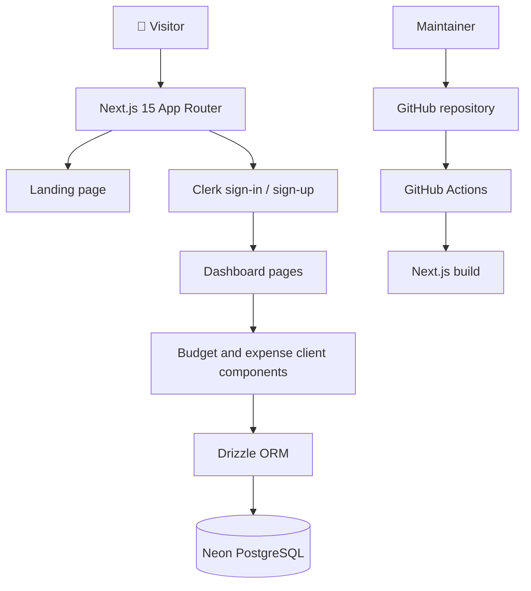
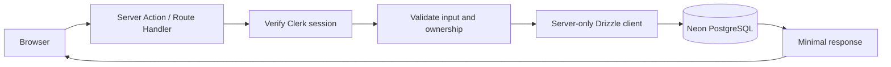

# 🌱 Budget Bloom
<p align="center">

  
  
  
  
  
</p>

<p align="center"><strong>A budget and expense tracking application prototype built with Next.js, Clerk, Neon PostgreSQL, and Drizzle ORM.</strong></p>
<p align="center">[🌱 Overview](#-overview) · [✨ Features](#-features) · [🏛️ Architecture](#-architecture) · [🧰 Setup](#-getting-started) · [📚 Docs](docs/README.md)</p>

---

## 🚨 Security warning

**Do not deploy this repository with real financial or personal data in its current state.** Runtime database access is currently initiated from browser-side components using `NEXT_PUBLIC_DATABASE_URL`. Next.js publishes variables with the `NEXT_PUBLIC_` prefix in browser JavaScript. Several data operations also lack trusted server-side ownership checks. Client-side filtering by email or record ID is not authorization.

Use disposable development data only. Move all database access to server-only operations, use a server-only database URL, verify Clerk identity for every operation, enforce per-user ownership, and reconcile migrations before production use. Rotate any privileged credential that may have entered a browser bundle. Read [Security Policy](SECURITY.md) and [Deployment](docs/deployment.md).

## 🌼 Overview

Budget Bloom is an expense and budget tracker prototype. The application allows a visitor to explore the landing page and offers signed-in UI for viewing a dashboard, organizing budgets, and managing expenses associated with budgets.

The Git repository root contains project documentation and a placeholder package manifest. The actual Next.js application, dependencies, and scripts are inside **`expense/`**. Run all application npm commands from that directory.

## ✨ Features

| Feature | Description | Current state |
|---|---|---|
| 🌱 Landing page | Public product introduction | Implemented |
| 🔐 Sign in / Sign up | Clerk authentication UI | Implemented |
| 📊 Dashboard | Summary cards, chart, latest budgets and expenses | Implemented, security-limited |
| 💰 Budgets | Budget listing and creation interface | Implemented, validation review needed |
| 🧾 Expenses | Expense listing and budget-linked expense controls | Implemented, security-limited |
| 📈 Charts | Dashboard visualization using Recharts | Implemented |
| ℹ️ About | Product information page | Implemented |

The feature table describes visible code paths, not a claim of secure multi-user behavior. See [Feature Inventory](docs/product/features.md) for detail.

## 🧰 Technology stack

| Layer | Technology | Role |
|---|---|---|
| Framework | Next.js 15 App Router | Application routes and rendering |
| UI | React 18 | Interactive components |
| Identity | Clerk | Sign-in/sign-up UI and user state |
| Database | Neon PostgreSQL | Intended persistent data store |
| ORM | Drizzle ORM | Schema declarations and queries |
| Styling | Tailwind CSS 4 | Utility-first styling |
| Components | Radix UI / shadcn-style components | UI primitives |
| Charts | Recharts | Dashboard charts |
| Icons | Lucide React | Interface icons |
| Notifications | Sonner | Toast notifications |
| Package manager | npm | Dependency management |

## 🏛️ Architecture



**Important:** The diagram depicts the current prototype flow, including its unsafe client-to-database boundary. It is not a recommended production architecture. The required future architecture is:



## 🌳 Repository structure

```text
Budget-Bloom/
├── .github/
│   └── workflows/              # Repository automation
├── docs/
│   ├── product/                # Product brief, features, journeys, glossary
│   ├── quality/                # Testing strategy and QA checklist
│   ├── operations/             # Environment, incident, backup, rollback
│   ├── security/               # Threat model and data handling
│   ├── diagrams/               # Mermaid source diagrams
│   └── templates/              # ADR, feature, bug, test, incident, risk, release
├── expense/                    # ✅ Actual Next.js application root
│   ├── app/
│   │   ├── (auth)/             # Clerk sign-in and sign-up
│   │   ├── dashboard/          # Dashboard, budgets, expenses, about
│   │   ├── _components/        # Landing/header components
│   │   └── layout.tsx          # Root layout and providers
│   ├── components/ui/          # UI primitives
│   ├── utils/
│   │   ├── schema.js           # Drizzle budgets/expenses schema
│   │   └── dbConfig.jsx        # Current Neon client (security issue)
│   ├── drizzle/                # Existing initial migration metadata
│   ├── public/                 # Images and static assets
│   ├── package.json            # App scripts and dependencies
│   └── package-lock.json
├── .env.example                # Placeholder environment configuration
├── README.md                   # Main project overview
├── SECURITY.md                 # Vulnerability reporting and warnings
├── CONTRIBUTING.md
├── CODE_OF_CONDUCT.md
├── SUPPORT.md
├── CHANGELOG.md
├── ROADMAP.md
└── LICENSE
```

## 🧰 Getting started

### Prerequisites

- Node.js 18.18 or newer.
- npm.
- A Clerk development application.
- A disposable Neon development database, only if exercising persistence flows.

### 1. Clone the repository

```bash
git clone https://github.com/Brajesh31/Budget-Bloom.git
cd Budget-Bloom
```

### 2. Configure local environment

PowerShell:

```powershell
Copy-Item .env.example expense/.env
```

macOS/Linux:

```bash
cp .env.example expense/.env
```

Edit `expense/.env` with development-only values. Never commit it.

<blockquote>
**Critical:** Do not put a privileged Neon connection string in `NEXT_PUBLIC_DATABASE_URL`. That value is exposed to browser code in the current implementation. Use synthetic data and disposable credentials only until the database layer is moved server-side.
</blockquote>

### 3. Install dependencies

```bash
cd expense
npm ci
```

### 4. Start development server

```bash
npm run dev
```

Open [http://localhost:3000](http://localhost:3000).

### 5. Available scripts

Run these from `expense/`.

| Command | Purpose |
|---|---|
| `npm run dev` | Start Next.js development server |
| `npm run build` | Create production build |
| `npm run start` | Serve production build |
| `npm run lint` | Run configured Next.js lint command |
| `npm run db:push` | Drizzle schema push, currently blocked by schema/config drift |
| `npm run db:studio` | Open Drizzle Studio |

The scripts are declared in `expense/package.json`. This documentation update did not execute them.

## 🧭 Application routes

| Route | Purpose |
|---|---|
| `/` | Landing page |
| `/sign-in` | Clerk sign-in UI |
| `/sign-up` | Clerk sign-up UI |
| `/dashboard` | Dashboard overview |
| `/dashboard/budgets` | Budget list and creation UI |
| `/dashboard/expensesdashboard` | Expense listing |
| `/dashboard/expenses/[id]` | Budget detail and expense controls |
| `/dashboard/about` | About page |

Route existence does not mean access control is correctly enforced. Read the security documentation.

## 🗃️ Database and migration status

The current source declares `budgets` and `expenses` in `expense/utils/schema.js`. However:
- `expense/drizzle.config.mjs` references `utils/schema.ts`, which is not tracked.
- The existing SQL migration and snapshot only define the budgets table.
- Migration metadata differs from the current schema's amount type.
- Runtime code reads `NEXT_PUBLIC_DATABASE_URL`; Drizzle CLI reads `DATABASE_URL`.

Do not run schema push against production or valuable data until this drift is reconciled and a tested migration plan exists. More details: [Database documentation](docs/database.md).

## 🧪 Quality and testing

The repository does not currently contain a verified automated unit, integration, end-to-end, or authorization test suite. Before treating the app as production-ready, add coverage for amount calculations, CRUD operations, input validation, record ownership, anonymous access, migration integrity, and browser accessibility.

See [Testing Strategy](docs/quality/testing-strategy.md) and [QA Checklist](docs/quality/qa-checklist.md). Do not claim checks passed unless actually executed.

## 🔐 Security and privacy

Budget and expense entries can reveal sensitive financial behavior. The current database credential and authorization design are not suitable for real user data. Required work includes:
1. Move DB access into server-only code.
2. Use a server-only database secret.
3. Verify Clerk identity on every protected operation.
4. Enforce owner isolation for every read/write/delete.
5. Align schema and migrations.
6. Add authorization tests, privacy controls, backup and deletion procedures.

## 📚 Documentation

Start at the [Documentation Hub](docs/README.md).

- [Product brief](docs/product/project-brief.md)
- [Feature inventory](docs/product/features.md)
- [User journeys](docs/product/user-journeys.md)
- [Architecture](docs/architecture.md)
- [Database](docs/database.md)
- [API and integrations](docs/api.md)
- [Installation](docs/installation.md)
- [Development](docs/development.md)
- [Deployment](docs/deployment.md)
- [Threat model](docs/security/threat-model.md)
- [Testing strategy](docs/quality/testing-strategy.md)
- [Operations](docs/operations/environment.md)

## 🤝 Contributing

Read [CONTRIBUTING.md](CONTRIBUTING.md), follow the [Code of Conduct](CODE_OF_CONDUCT.md), and report vulnerabilities privately according to [SECURITY.md](SECURITY.md). Never use real personal financial data in issues or pull requests.

## 📄 License

Original project code and documentation are licensed under MIT. See [LICENSE](LICENSE). Third-party assets may have separate licenses. Verify rights before reuse.

## 👤 Maintainer

Brajesh Kumar · [GitHub @Brajesh31](https://github.com/Brajesh31)

Last updated: 2026-11-17 18:50 UTC
