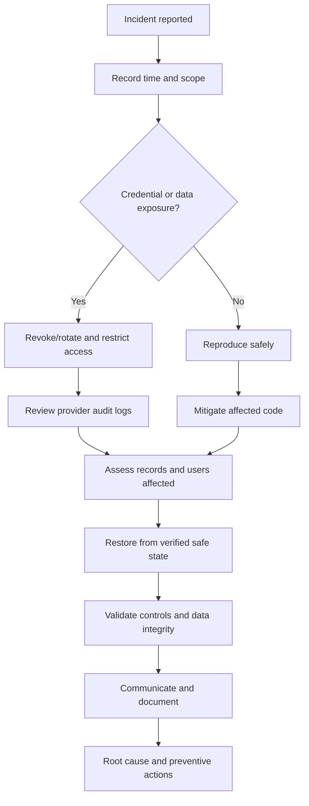

# 🚨 Incident Response

## Goals

Contain incidents involving exposed credentials, cross-user data access, unavailable services, corrupted schema, or accidental disclosure. Protect people and their information before restoring feature availability.

## Severity guide

| Level | Example | Priority action |
|---|---|---|
| Critical | Privileged DB URL published or unauthorized financial data access | Revoke credential, disable affected access, investigate immediately |
| High | Confirmed cross-account record access or destructive write bug | Contain affected operations and assess impacted users/data |
| Medium | Persistent failure affecting key dashboard flows | Mitigate and prepare a fix |
| Low | Documentation or non-sensitive UI issue | Track and schedule |

## Response workflow

## Evidence handling

Record relevant commit SHA, timestamps with timezone, environment, affected routes, provider event IDs, and sanitized logs. Do not copy secrets or real financial records into the incident document. Limit access to evidence.

## Exposed credential playbook

1. Revoke/rotate the credential at its provider immediately.
2. Remove it from active deployment configuration and code.
3. Inspect browser bundles, source maps, build artifacts, logs, and Git history.
4. Review Neon audit/connection activity and affected data.
5. Restore service using server-only credentials after access controls are corrected.
6. Document scope and user notification obligations.

Deleting the string from the latest commit is not enough. Treat an exposed credential as compromised.
