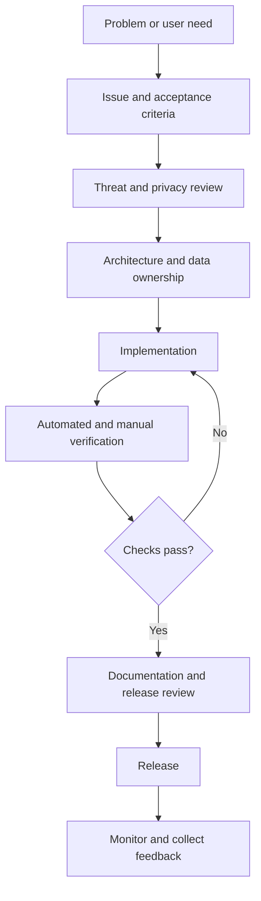

# ✨ Feature Inventory

This inventory records what can be identified in the current repository. A visible page or component does not imply secure authorization, complete validation, or production readiness.

| Feature | Current source area | Status | Notes |
|---|---|---|---|
| 🌱 Landing page | `expense/app/page.tsx`, `_components/Hero.jsx` | Present | Public project presentation |
| 🔑 Sign in | `expense/app/(auth)/sign-in/` | Present | Clerk UI |
| 📝 Sign up | `expense/app/(auth)/sign-up/` | Present | Clerk UI |
| 📊 Dashboard overview | `expense/app/dashboard/page.tsx` | Present, security-limited | Summary cards, charts, latest entries |
| 💰 Budget listing | `expense/app/dashboard/budgets/` | Present | UI and database calls |
| ➕ Budget creation | Budget components | Present, needs validation review | Verify server-side validation before use |
| 🧾 Expense listing | `expense/app/dashboard/expensesdashboard/` | Present | Data is queried from browser-side code |
| ✏️ Budget/expense detail controls | `expense/app/dashboard/expenses/[id]/` | Present, security-limited | Verify owner checks and mutation behavior |
| 📈 Charts | Dashboard chart components | Present | Uses Recharts |
| ℹ️ About page | `expense/app/dashboard/about/` | Present | Informational content |

## ⚠️ Cross-cutting limitations

- Database access is imported by client components.
- Runtime code reads `NEXT_PUBLIC_DATABASE_URL`, which is exposed to browser code.
- Several queries rely on the current user's email or resource IDs from the browser, not a trusted server-side authorization boundary.
- Clerk middleware initializes Clerk but does not explicitly protect routes in its current configuration.
- Drizzle schema/config/migration files are inconsistent.
- Automated unit, integration, and browser test suites are not established in the repository.

## 🗺️ Feature lifecycle for new work

## ✅ Definition of done

A feature is not done until user behavior, failure states, authorization, input validation, accessibility, responsive behavior, automated checks, documentation, and rollback implications have been reviewed. Mark any unimplemented part as a known limitation.
