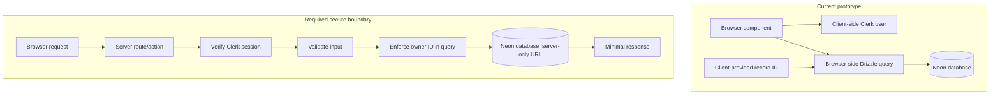

# 🧑‍🤝‍🧑 User Journeys

These journeys describe the intended UI flow visible from the route structure. They do not claim secure production authorization.

## 1. New visitor

1. Opens the landing page at `/`.
2. Reviews the product introduction.
3. Selects sign-up or sign-in.
4. Completes the Clerk-hosted or embedded authentication UI.
5. Reaches an application route as configured by Clerk.

## 2. Budget management

1. Opens `/dashboard/budgets`.
2. Reviews the budget list.
3. Opens the budget creation interface.
4. Enters a name, amount, and optional icon.
5. Submits the form.
6. Reviews the displayed budget and dashboard summary.

Expected future safeguards: server-side ownership assignment, positive/valid amount validation, currency policy, duplicate handling, useful failure feedback, and authorization tests.

## 3. Expense tracking

1. Opens an expense listing or a budget detail route.
2. Selects a budget.
3. Adds an expense with a name and amount.
4. Reviews the updated list and budget total.
5. Edits or deletes an entry when those controls are available.

Expected future safeguards: validate amounts and relationships on the server, confirm the selected budget belongs to the authenticated user, and ensure updates/deletes cannot target another user's records.

## 4. Current vs desired authorization

The desired flow is a roadmap item, not current functionality.

## 5. Error and recovery experience

Forms should preserve safe user input after recoverable errors, explain what needs correction, avoid leaking SQL or credential details, and provide a retry path for transient failures. Do not display raw exception objects to users.
